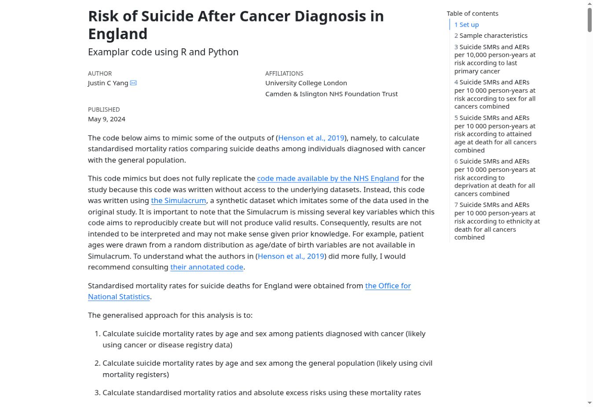
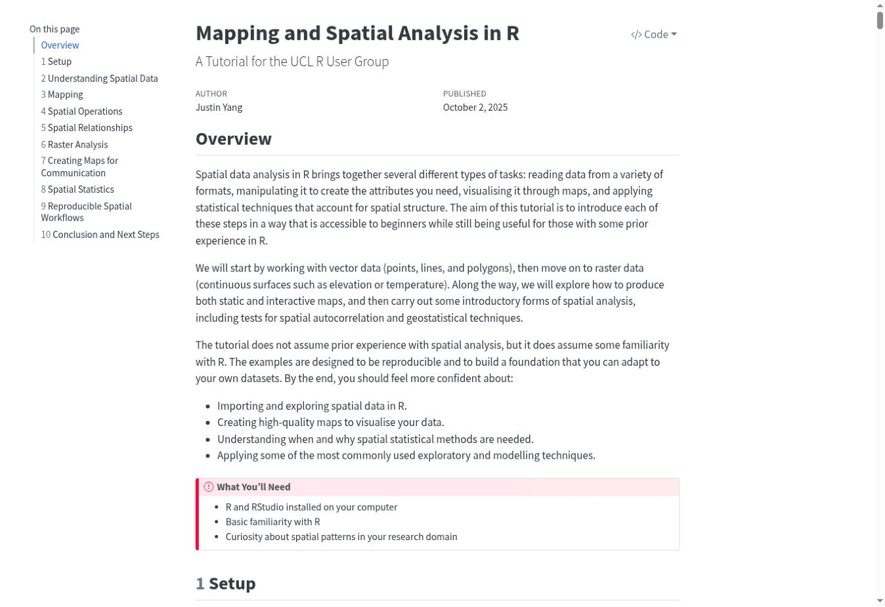
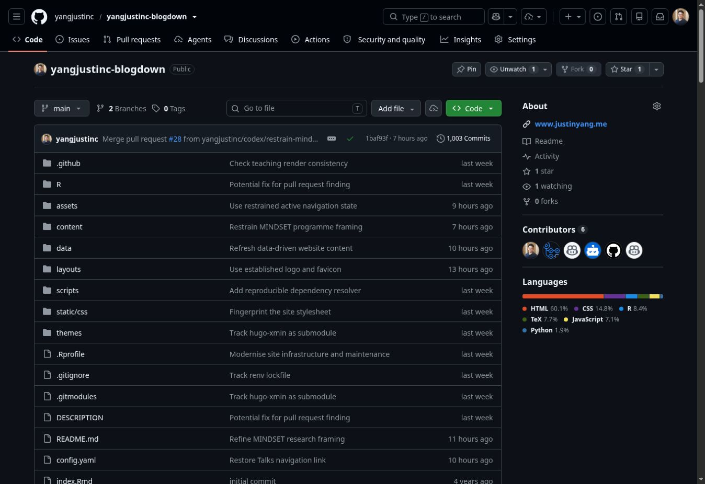

Most of my research uses data that cannot be shared, so I release the analysis code and teaching materials instead. Stable releases are archived on Zenodo with DOIs. Many of my publications have freely accessible versions; see [Publications](../publications/) for DOI and open access links.

## Research code

<article class="resource-feature">
  <a class="resource-feature-preview resource-feature-code" href="https://github.com/yangjustinc/hopesen" aria-label="Open HOPESEN analytical code on GitHub">
    ECHILD · R
    <strong>HOPESEN</strong>
    linked administrative data reproducible analysis
  </a>
  

    <h2>HOPESEN: SEND provision and secondary school outcomes</h2>
    
<a href="https://github.com/yangjustinc/hopesen"><b>HOPESEN</b></a> provides the analytical code for population-based analyses of SEND provision profiles and education and health outcomes among secondary school pupils in England using the ECHILD Research Database.

    
It includes linked data cohort construction, outcome derivation, descriptive analyses, and fixed effects Poisson regression workflows for the ONS Secure Research Service, while documenting practical reproducibility constraints in an air-gapped trusted research environment.

    
<a href="https://github.com/yangjustinc/hopesen">Source code and documentation</a> · <a href="https://doi.org/10.5281/zenodo.22710433">Archived v1.0.0 release and DOI</a>

  

</article>

## Teaching and methods resources

<article class="resource-feature">
  <a class="resource-feature-preview resource-feature-code" href="https://yangjustinc.github.io/good-practice-r-ons-srs/" aria-label="Open Good Practice for R Users When Working in the ONS SRS">
    ONS SRS · R
    <strong>Good practice in R</strong>
    large linked data trusted research environments
  </a>
  

    <h2>Good practice in R for secure research environments</h2>
    
<a href="https://yangjustinc.github.io/good-practice-r-ons-srs/"><b>Good Practice for R Users When Working in the ONS SRS</b></a> provides materials for a one hour workshop on writing efficient, reproducible, and robust R code for large linked administrative data in the ONS Secure Research Service and similar trusted research environments. It was developed for a workshop through <a href="https://dataciseopenlearning.org/courses/good-practice-for-r-users-when-working-in-the-ons-srs/">Datacise Open Learning</a> on 25 November 2026, and the lesson notes can be read without running any code.

    
It covers analytical units and join checks, reducing data early and letting the database do the work, managing memory and recomputation, telling missing records from true zeroes, and rerunnable pipelines. Because SRS data cannot leave the SRS, the worked example uses public New York City trip records with the same structural problems, about 240 million rows a year, in data.table, dplyr, Arrow, and dbplyr. <a href="https://github.com/yangjustinc/good-practice-r-ons-srs">Source code and lesson notes</a> · <a href="https://doi.org/10.5281/zenodo.24343725">Archived v1.0.0 release and DOI</a>

  

</article>

<article class="resource-feature">
  
  

    <h2>Routine data analysis across R, Python, and Stata</h2>
    
<a href="https://yangjustinc.github.io/2024-ncras/"><b>Risk of Suicide After Cancer Diagnosis in England</b></a> is a worked teaching resource demonstrating approaches to analysing routinely collected health data. It covers survival analysis workflows, person-time, standardised mortality ratios, and absolute excess risks, with examples in R, Python, and Stata.

    
The material uses synthetic and published data for methodological and educational purposes. <a href="https://github.com/yangjustinc/2024-ncras">Source code and documentation</a> · <a href="https://doi.org/10.5281/zenodo.22710447">Archived v1.0.0 release and DOI</a>

  

</article>

<article class="resource-feature">
  
  

    <h2>Mapping and spatial analysis in R</h2>
    
<a href="https://yangjustinc.github.io/2025-mapping-and-spatial-analysis-in-r/"><b>Mapping and Spatial Analysis in R</b></a> is an introductory tutorial developed for the UCL R User Group. It covers spatial data structures, coordinate reference systems, vector and raster analysis, mapping, spatial joins, proximity and adjacency, spatial autocorrelation, hotspot analysis, and introductory spatial interpolation.

    
The tutorial is designed for researchers and analysts with basic R experience who are new to spatial analysis. <a href="https://github.com/yangjustinc/2025-mapping-and-spatial-analysis-in-r">Source materials</a> · <a href="https://doi.org/10.5281/zenodo.22710469">Archived v1.0.0 release and DOI</a>

  

</article>

## Open infrastructure

<article class="resource-feature">
  
  

    <h2>Reproducible website infrastructure</h2>
    
The <a href="https://github.com/yangjustinc/yangjustinc-blogdown"><b>website source</b></a> is public. The site uses Hugo, R, ORCID, OpenAlex, Crossref, GitHub Actions, and small curated data files to maintain publications, funding, talks, teaching, and other academic content with limited manual duplication.

    
The repository documents the build, dependency management, content refresh, and validation workflow.

  

</article>

## More code, talks, and materials

Additional public repositories are available through my [GitHub profile](https://github.com/yangjustinc), including the materials for a [four session course in reproducible analysis in R and Python](https://yangjustinc.github.io/2026-10-14-ucldop-online/) for mental health researchers. Talks and methods courses are listed under [Talks](../talks/).

Outputs from UNITED, my NIHR Team Science award on England's national drug and alcohol treatment data, are collected on the [UNITED project website](https://yangjustinc.github.io/united/), including the scoping review preprint, a conference poster, and the recording and slides of a November 2026 Lunch and Learn with the NIHR Public Health Policy Research Unit.

Code and materials for specific projects are also linked from the relevant [research](../research/), [publication](../publications/), and [teaching](../teaching/) pages where available.
